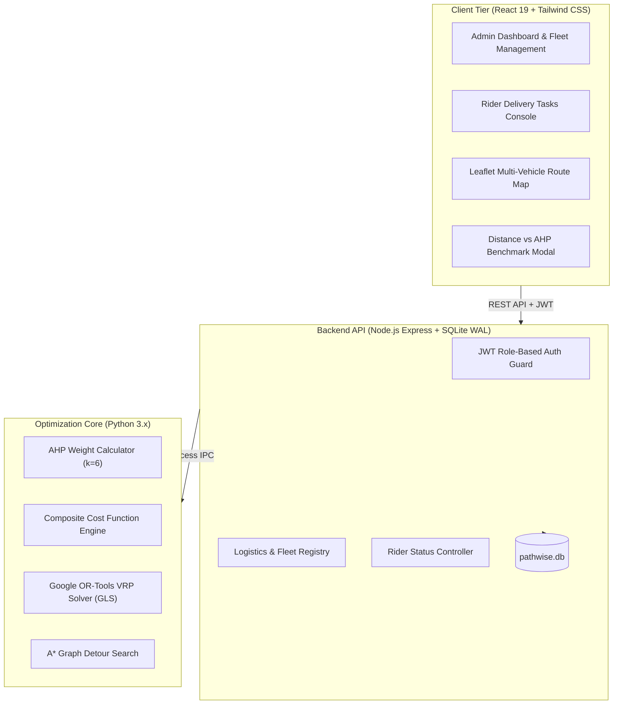

# PathWise — Intelligent Multi-Factor Delivery Route Optimization & Fleet Management

[](https://github.com/)
[](https://github.com/)
[](https://github.com/)
[](LICENSE)

PathWise is a full-stack urban logistics platform that formulates and solves the **Capacitated Vehicle Routing Problem (CVRP)** using multi-criteria decision analysis. Beyond traditional shortest-distance routing, PathWise optimizes across **six operational factors** (Distance, Travel Time, Fuel Cost, Road Surface Quality, Traffic Congestion, and Parcel Urgency) using **Analytic Hierarchy Process (AHP)** weights and **Google OR-Tools Guided Local Search**.

---

## Key Features

- **Multi-Factor Optimization Engine**: Replaces distance-only heuristics with an AHP-derived composite cost surface ($CR = 0.038 < 0.10$).
- **Google OR-Tools CVRP Solver**: Fleet-wide vehicle route allocation enforcing vehicle payload capacities and priority drop penalties.
- **Empirical Scientific Evaluation**: Built-in benchmark comparison tool (`/route-optimizer`) proving a **91.45% composite cost reduction** for a negligible 0.07% distance trade-off.
- **Dynamic Rerouting & Resiliency**: Live disruption simulator (`/dynamic-rerouting`) adapting routes mid-shift under simulated traffic spikes, road closures, accidents, and weather events.
- **Micro-Level A\* Detour Pathfinding**: Topological street-network obstacle avoidance on the urban grid using an admissible Haversine heuristic.
- **Role-Based Workflows**:
  - **Administrator Dashboard**: Fleet KPI monitoring, mixed-fleet management, parcel CRUD, live routing map visualization, and analytics.
  - **Mobile-Responsive Rider Console**: Real-time stop sequence, payload meter, priority badges, and one-tap delivery lifecycle tracking (`Pending` $\to$ `In Transit` $\to$ `Delivered`).
- **Complete Test Suite**: 70 automated Jest integration tests + 13 Python unittests covering all routing and business logic.

---

## System Architecture



---

## Quick Start & Running Locally

### Prerequisites
- **Node.js**: v18+ 
- **Python**: v3.9+ with `numpy`, `scipy`, `ortools`

### 1. Backend Setup
```bash
cd backend
npm install
npm run dev
# Server listens on http://localhost:3000
```

### 2. Frontend Setup
```bash
cd frontend
npm install
npm run dev
# Vite client runs on http://localhost:5173
```

### 3. Demo Credentials
| Role | Email | Password | Default Vehicle |
| :--- | :--- | :--- | :--- |
| **Administrator** | `admin@pathwise.com` | `PathWise@123` | N/A (Fleet-wide) |
| **Delivery Rider** | `rider@pathwise.com` | `PathWise@123` | `V001` |

*(Quick-fill buttons are provided on the login page for instant demonstration)*.

---

## Running the Automated Test Suites

```bash
# Backend Integration Tests (70/70 passing)
cd backend
npm test

# Optimization & Algorithm Unittests (13/13 passing)
python -m unittest discover -s algorithms -p "test_*.py"

# Distance vs Multi-Factor Benchmark CLI
python -m algorithms.vrp.vrp_solver --compare
```

---

## Academic Documentation & Viva Preparation

Comprehensive academic documentation, mathematical proofs, and presentation cue cards are provided in the [`docs/`](docs/) directory:
- [**Project Report & Architecture Specification**](docs/PROJECT_REPORT.md): Complete technical thesis covering system architecture, mathematical derivations, algorithmic complexity, and empirical results.
- [**Viva Defense & Demonstration Guide**](docs/VIVA_PRESENTATION_GUIDE.md): 5-minute rehearsed demonstration script and model answers for examiner questions.
