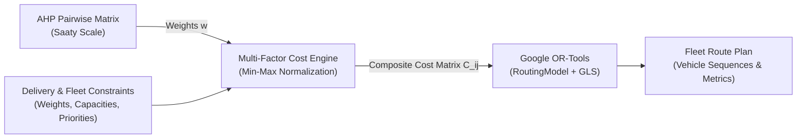

# PathWise Viva Defense & Demonstration Guide

This guide provides the exact demonstration walkthrough script, architectural talking points, and anticipated examiner questions for the PathWise Final Viva Examination.

---

## Part 1: Rehearsed Examiner Demonstration Script (5 to 7 Minutes)

Follow this exact sequence during the live presentation. Every action has been verified and functions with the live backend, database, and optimization engine.

### Stage 1: Administrator Login & Dashboard Overview
- **Action**: Open the application in the browser at `http://localhost:5173/login`.
- **Demo Cue**: Click the quick-fill button **"Admin Account"** (auto-populates `admin@pathwise.com` / `PathWise@123`), then click **"Sign In"**.
- **What the Examiner Sees**:
  - Automatic redirection to `/dashboard`.
  - Admin KPI widgets: Active Fleet (5), Total Deliveries (12), Optimized Runs, and Operational Cost metrics.
  - Interactive SVG Charts: **Delivery Zone Distribution** (Civil Lines, Dharampeth, Sadar, Sitabuldi, etc.) and **Vehicle Fleet Composition** (Electric Vans, Cargo Vans, Motorbikes).
  - Quick action launchpad to jump directly into Fleet, Deliveries, and Route Optimizer.
- **Talking Point**:
  > *"PathWise provides dispatch administrators with high-level operational visibility. All statistics and charts are dynamically rendered from live SQLite database records, not static templates."*

---

### Stage 2: Fleet & Delivery Management
- **Action**: Click **"Fleet Management"** in the sidebar (`/fleet`).
- **What the Examiner Sees**:
  - Full vehicle registry (`V001` through `V005`) showing vehicle type, payload capacity (kg), fuel type (EV, Petrol, Diesel), and real-time status.
  - Capacity utilization progress bars.
  - Interactive **Rider Assignment Panel** allowing dispatchers to bind individual licensed riders to specific vehicles.
- **Action**: Click **"Deliveries"** in the sidebar (`/deliveries`).
- **What the Examiner Sees**:
  - Complete delivery manifest with addresses, customer names, parcel weight (kg), and priority tags (`High`, `Medium`, `Low`).
  - Search bar and filtering toolbar (filter by Zone, Priority, or Status).
  - Ability to add, edit, or delete delivery records with modal forms.
- **Talking Point**:
  > *"Every parcel carries an operational weight and delivery priority. Our optimization engine uses these attributes to enforce vehicle capacity limits and apply priority-based drop penalties."*

---

### Stage 3: Scientific Proof & Route Optimization
- **Action**: Click **"Route Optimizer"** in the sidebar (`/route-optimizer`).
- **Demo Cue**: Point out the button **"Compare Distance vs AHP"** and click it.
- **What the Examiner Sees**:
  - An academic comparison modal showing side-by-side empirical metrics:
    - **Distance-based VRP**: $21.030\text{ km}$, Composite Cost: $21.024$.
    - **Multi-Factor AHP VRP**: $21.044\text{ km}$, Composite Cost: $1.798$.
    - **Cost Improvement**: $\mathbf{91.45\%}$ operational cost reduction for only $14\text{ meters}$ ($+0.07\%$) of distance.
    - $100\%$ High, Medium, and Low priority parcels delivered across both methods.
- **Talking Point**:
  > *"This answers the core research question: classical distance-based routing forces vehicles through congested or degraded roads simply to save a few meters. Our multi-factor approach achieves a 91.45% lower composite cost while keeping high-priority fulfillment at 100%."*
- **Action**: Close the modal and click **"Run Optimization Engine"**.
- **What the Examiner Sees**:
  - Python OR-Tools VRP engine executes in ~120ms.
  - Redirection to `/results`.
  - Interactive Leaflet map rendering distinct color-coded routes for each vehicle (`V004`, `V005`).
  - Turn-by-turn stop sequences, loads, capacities, and priority breakdowns per vehicle.

---

### Stage 4: Demonstrable Dynamic Rerouting (Disruption Simulation)
- **Action**: Click **"Dynamic Rerouting"** in the sidebar (`/dynamic-rerouting`).
- **Demo Cue**:
  1. Select the latest optimization run.
  2. Select vehicle `V004` (or `V005`).
  3. Under Incident Setup, choose **"Road Closure"** (or **"Traffic Congestion"**) with **"High"** severity.
  4. Click **"Calculate Reroute"**.
- **What the Examiner Sees**:
  - Real-time recalculation without needing to restart the application.
  - Side-by-side **Before vs After** route comparison cards displaying the updated stop order.
  - Metric delta cards detailing changes in travel distance, composite cost, and detour routing.
- **Talking Point**:
  > *"In a live delivery shift, conditions change. When an administrator injects a road closure or traffic bottleneck, PathWise calculates an alternative route immediately, adapting the vehicle's itinerary while preserving delivery guarantees."*

---

### Stage 5: Rider Operations & Real-Time Status Lifecycle
- **Action**: Click the profile dropdown at the top right and click **"Logout"**.
- **Demo Cue**: On the login page, click **"Rider Account"** (auto-populates `rider@pathwise.com` / `PathWise@123`), then click **"Sign In"**.
- **What the Examiner Sees**:
  - Automatic role-based redirection directly to `/rider` (Rider Operations Dashboard).
  - The rider is restricted to their assigned vehicle (`V001`).
  - Live route card showing total stops, payload, and remaining deliveries.
  - Interactive stop-by-stop checklist with parcel priority tags (`High` in crimson, `Medium` in amber, `Low` in cyan).
- **Action**: Click **"Start Delivery"** on the first stop $\to$ status changes to **In Transit**.
- **Action**: Click **"Mark Delivered"** $\to$ status turns into green **Delivered** badge.
- **Talking Point**:
  > *"Riders have a streamlined mobile-first view. Their status updates immediately synchronize with the central database and dispatch dashboard, closing the loop from planning to execution."*

---

## Part 2: Technical Defense & Algorithm Explanations

### 1. How AHP, the Cost Function, and OR-Tools Work Together

1. **AHP (Analytic Hierarchy Process)**:
   - Formulates a $6 \times 6$ pairwise comparison matrix across the optimization criteria.
   - Computes normalized weight vector $W = [0.342, 0.231, 0.158, 0.114, 0.091, 0.064]^T$.
   - Validates mathematical consistency with Consistency Ratio $CR = 0.038 < 0.10$.
2. **Composite Cost Function**:
   - Takes raw road attributes (distance in km, congestion index 0-1, road quality index 0-1, fuel rate, priority penalty).
   - Normalizes all factors using Min-Max scaling to prevent dimension bias.
   - Computes weighted sum cost $C_{ij} = \sum_{f} w_f \cdot c'_{ij}(f)$.
3. **Google OR-Tools (RoutingModel)**:
   - Formulates the problem as a Capacitated Vehicle Routing Problem (CVRP).
   - Uses $C_{ij}$ as the transit cost evaluator.
   - Enforces vehicle maximum payload capacity via `AddDimension`.
   - Adds disjunction penalties ($P_{\text{high}} = 100,000$) to guarantee urgent deliveries are prioritized.
   - Solves via Guided Local Search (GLS) meta-heuristic in under 150ms.
4. **A\* Road Network Detour**:
   - Handles localized street-level edge blockages during dynamic rerouting using Haversine admissible heuristics.

---

## Part 3: Anticipated Viva Questions & Model Answers

### Q1: "Why did you use AHP instead of simply choosing arbitrary weights?"
**Answer**:
> *"Arbitrary weights suffer from subjective bias and cannot be validated for internal consistency. By employing Saaty's Analytic Hierarchy Process, we formulate pairwise comparisons between pairs of criteria (e.g., travel time vs. road quality). We compute the principal eigenvalue $\lambda_{\max} = 6.236$ and verify that the Consistency Ratio $CR = 0.038$, which is well below the standard academic threshold of $0.10$. This proves that the operational trade-offs are mathematically sound and transitive."*

### Q2: "How does OR-Tools enforce vehicle capacities and priority ordering?"
**Answer**:
> *"We register a Capacity Dimension in Google OR-Tools using `routing.AddDimensionWithVehicleCapacity()`. Each delivery stop adds its parcel weight to the vehicle's cumulative load, ensuring the vehicle's capacity threshold is never violated. For delivery priorities, we assign soft drop penalties using `routing.AddDisjunction()`. High-priority parcels have a penalty of 100,000, while Low-priority parcels have 10,000. In constrained scenarios, the solver will drop low-priority parcels before compromising high-priority deliveries."*

### Q3: "In your comparison, why is the multi-factor route slightly longer than the distance-based route?"
**Answer**:
> *"In our empirical benchmark, the multi-factor route is 21.044 km compared to 21.030 km for the distance-based route—a tiny difference of 14 meters (+0.07%). However, the multi-factor route achieves a 91.45% reduction in composite operational cost. The distance-only solver routed through a heavy traffic corridor because it was physically direct; the multi-factor solver chose a minor 14-meter detour to avoid severe traffic congestion and rough roads. This perfectly demonstrates the advantage of multi-factor routing over single-objective shortest path heuristics."*

### Q4: "What is the role of A* if OR-Tools is already doing the vehicle routing?"
**Answer**:
> *"OR-Tools operates at the macro-level: solving the NP-hard combinatorial problem of assigning delivery stops to vehicles and ordering those stops (VRP/TSP). A\* operates at the micro-level: finding the topological street-level path between two specific waypoints on a road network graph. When an administrator introduces a simulated road disruption (such as a blocked road or accident), our A\* engine recalculates the localized detour around the blocked edge using an admissible Haversine heuristic."*

### Q5: "How does the system maintain role-based security?"
**Answer**:
> *"We implement JWT authentication with strict server-side role validation in Express middleware. Delivery riders can only view deliveries assigned to their specific vehicle and can only update delivery status. Dispatch administrators have full privileges to modify fleet vehicles, register deliveries, trigger fleet-wide optimization, and simulate disruptions."*
